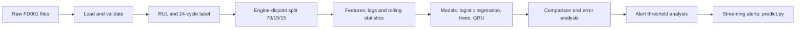

# Machinery Predictive Maintenance — NASA C-MAPSS FD001

Axlero Data Science & ML internship, Project 2. We predict, from an engine's sensor history, whether it will fail
within the next **24 operational cycles**, so that maintenance can be planned before an unplanned stop.

> **Status: prototype.** All results are validation results on **simulated** data and are **provisional**.
> The reserved test split has not been used, so there is no final, unbiased performance estimate yet.
> A "cycle" is not an hour: nothing here supports a claim of 24 hours of warning.

## Contents

1. [Problem](#1-problem)
2. [Dataset](#2-dataset)
3. [Repository structure](#3-repository-structure)
4. [Setup](#4-setup)
5. [Pipeline](#5-pipeline)
6. [Run instructions](#6-run-instructions)
7. [Evaluation and metrics](#7-evaluation-and-metrics)
8. [Alert threshold (provisional)](#8-alert-threshold-provisional)
9. [Limitations](#9-limitations)
10. [Known issues and housekeeping](#10-known-issues-and-housekeeping)
11. [Documentation, team and licence](#11-documentation-team-and-licence)

## 1. Problem

Unplanned equipment downtime is expensive; an unnecessary maintenance halt is also costly. The project brief asks for a model
that predicts failure *before* it happens, keeps false alarms low, and is validated without leaking future data.

- **Task:** binary classification. For each engine and cycle, predict whether the engine fails within the next 24 cycles.
- **Label:** `RUL = last_cycle - cycle` for each run-to-failure engine; `target = 1` when `RUL <= 24`, otherwise 0.
  The 24-cycle horizon is a provisional team choice, not an empirically optimal value.
- **Alerting:** an alert is raised when the predicted failure probability reaches a threshold. Choosing that threshold
  trades missed failures against false alarms (see [section 8](#8-alert-threshold-provisional)).

## 2. Dataset

| Item | Value |
|---|---|
| Dataset | NASA C-MAPSS Turbofan Engine Degradation Simulation, subset **FD001** |
| Source | <https://data.nasa.gov/dataset/cmapss-jet-engine-simulated-data> (see also the NASA Prognostics Data Repository) |
| Type | Simulated multivariate engine sensor time series, indexed by engine and operational cycle |
| FD001 | One operating condition, one fault mode |
| Training file | `train_FD001.txt`: 20,631 rows, 26 columns, 100 run-to-failure engines, no missing values |
| Columns | `unit_number`, `time_cycles`, `op_setting_1..3`, `sensor_1..21` |
| Class balance | 18,131 negative rows (87.9%), 2,500 positive rows (12.1%); every engine contributes exactly 25 positive rows |
| Constant channels | `op_setting_3`, `sensor_1`, `sensor_5`, `sensor_10`, `sensor_16`, `sensor_18`, `sensor_19`; `sensor_6` takes only two values |
| Test files | `test_FD001.txt` (truncated histories) and `RUL_FD001.txt`; reserved, see below |

**Licence and attribution.** An explicit licence was not identified in the NASA listing (see [dataset_selection.md](dataset_selection.md)).
Do not assume the data can be redistributed: **raw files are not committed** (they are git-ignored). Cite NASA and
Saxena et al. (2008), *Damage Propagation Modeling for Aircraft Engine Run-to-Failure Simulation*.

**Test data.** `test_FD001.txt` is reserved for a single final evaluation. `src/modeling/predict.py` uses it as a simulated
stream by default; **do not tune any model or threshold on its output.**

## 3. Repository structure

```text
src/
  data/        load_data.py, clean_fd001.py, preprocessing.py, target_labels.py, temporal_split.py,
               lag_features.py, inspect_dataset.py
  features/    rolling_features.py, build_features.py        # processed feature matrix
  modeling/    train_baseline.py, train_gru.py, compare_baseline_gru.py, compare_models.py,
               threshold_analysis.py, predict.py            # models, comparison, thresholds, streaming alerts
  models/      evaluate_models.py                           # Week 3 comparison on an 80/20 engine split
notebooks/     01_eda_fd001.py, 01b_eda_class_balance_trends_noise.py, 02_feature_quality.py,
               03_model_comparison.py, 04_threshold_analysis.py, FD001_Dataset_Inspection.ipynb
tests/         unit tests for each module
reports/       generated results and decision documents (see section 11)
artifacts/     trained GRU model and preprocessing objects used by predict.py
data/          NOT in the repository. You create data/raw/CMAPSSData/ locally (section 4); data/processed/ is generated.
```

The notebooks are plain `.py` files with `# %%` cell markers: open them in VS Code and use *Run Cell*, or run them with `python`.

## 4. Setup

Requires **Python 3.10 or newer** (verified on 3.12 and 3.14).

1. **Create an environment and install dependencies** (from the repository root):

   ```powershell
   # Windows (PowerShell)
   py -m venv .venv
   .\.venv\Scripts\Activate.ps1
   python -m pip install -r requirements.txt
   ```

   ```bash
   # macOS / Linux
   python3 -m venv .venv
   source .venv/bin/activate
   python -m pip install -r requirements.txt
   ```

   The GRU prototype and `predict.py` additionally need PyTorch: `python -m pip install -r requirements-gru.txt`.
   Everything else, including the model comparison and threshold analysis, runs without it.

2. **Download the data.** Get `CMAPSSData.zip` from the NASA link above, unzip it, and copy the three FD001 files into
   `data/raw/CMAPSSData/`:

   ```powershell
   New-Item -ItemType Directory -Force data/raw/CMAPSSData     # Windows; on macOS/Linux: mkdir -p data/raw/CMAPSSData
   Copy-Item <path-to-unzipped>\CMAPSSData\*FD001.txt data\raw\CMAPSSData\
   ```

   Required: `train_FD001.txt`, `test_FD001.txt`, `RUL_FD001.txt`.

3. **Check the installation:**

   ```bash
   python -m pytest -q
   ```

   All tests should pass. `tests/test_predict.py` imports PyTorch; without it, run
   `python -m pytest -q --ignore=tests/test_predict.py`.

Verified on a fresh install on Linux with Python 3.12 (pandas 3.0-3.1, numpy 2.4-2.5, scikit-learn 1.8-1.9,
matplotlib 3.10-3.11), and run on Windows with Python 3.14 by a team member. Results from the tree and logistic-regression
models can differ slightly with other library versions (see [Limitations](#9-limitations)).

## 5. Pipeline



| Stage | Code | Notes |
|---|---|---|
| Load and validate | `src/data/load_data.py`, `preprocessing.py`, `clean_fd001.py` | Checks columns, numeric types, consecutive cycles |
| Label | `src/data/target_labels.py` | `rul`, `target` (horizon 24 cycles) |
| Split | `src/data/temporal_split.py` | Engines sorted by ID: first 70% train, next 15% validation, last 15% test. No engine appears in two splits. |
| Features | `src/data/lag_features.py`, `src/features/rolling_features.py`, `build_features.py` | Lags 1/5/10 and rolling mean/std/min/max over 5/10/20 cycles, computed from past cycles only. Constant channels are dropped using training engines only. 242 features. FFT features are not built: FD001 has no vibration waveform (see `techical rationale.md`). |
| Models | `train_baseline.py`, `train_gru.py`, `compare_models.py`, `src/models/evaluate_models.py` | Logistic regression, gradient-boosted trees, Random Forest, GRU |
| Threshold analysis | `src/modeling/threshold_analysis.py` | Precision-recall trade-off, engine-level warning behaviour, cost of errors |
| Streaming alerts | `src/modeling/predict.py` | Scores one row at a time with the GRU; needs PyTorch |

**Leakage controls:** the split is by engine; lag and rolling features use earlier cycles of the same engine only; imputation
and scaling are fitted on training rows only; `rul`, `target` and `split` are never model inputs.

## 6. Run instructions

Run everything from the repository root. Expected run times are for a typical laptop. Scripts overwrite files in `reports/`
(some are tracked in git), so check `git diff` and commit only what you intend.

| # | Step | Command | Main outputs |
|---|---|---|---|
| 1 | Clean the data | `python -m src.data.clean_fd001 --input data/raw/CMAPSSData/train_FD001.txt` | `data/processed/train_FD001_clean.csv` |
| 2 | Baseline (logistic regression) | `python -m src.modeling.train_baseline` | `reports/baseline_metrics.md` |
| 3 | Build the feature matrix | `python -m src.features.build_features` | `data/processed/features_fd001.csv`, `reports/feature_manifest.csv` |
| 4 | Compare models (shared validation split) | `python -m src.modeling.compare_models` | `reports/model_comparison.md`, `model_predictions_val.csv` |
| 5 | Threshold analysis | `python -m src.modeling.threshold_analysis` | `reports/threshold_analysis.md`, `provisional_threshold.json` |
| 6 | Week 3 model evaluation (80/20 split) | `python -m src.models.evaluate_models` | `reports/model_evaluation_summary.md` (needs step 1) |

Step 3 prints `rows: 20631` and `model_features: 242`, plus a SHA-256 of the output; two runs on the same machine give the same
value. Step 5 takes about a minute (it fits five model variants); add `--no-robust` for a quick run.

**Notebooks** (each reads the outputs of a step above):

```bash
python notebooks/01_eda_fd001.py                        # after step 1
python notebooks/01b_eda_class_balance_trends_noise.py  # raw data only
python notebooks/02_feature_quality.py                  # after step 3
python notebooks/03_model_comparison.py                 # after step 4
python notebooks/04_threshold_analysis.py               # after step 5
```

**GRU and streaming alerts (need PyTorch; a GPU is recommended for training):**

```bash
python -m pip install -r requirements-gru.txt
python -m src.modeling.train_gru              # trains the GRU, writes artifacts/ and reports/gru_metrics.md
python -m src.modeling.compare_baseline_gru   # logistic regression vs GRU on identical validation rows
python -m src.modeling.predict                # simulates a stream from the FD001 test file, writes reports/streaming_predictions.csv
python -m src.modeling.predict --input my_rows.csv --output out.csv   # your own rows (needs the model's feature columns)
```

The committed `artifacts/gru_model.pth` is what `predict.py` loads. GPU training is not bit-for-bit reproducible.

## 7. Evaluation and metrics

**Metrics.** *Precision*: of the alerts raised, the share that were correct. *Recall*: of the rows inside the failure window, the
share flagged. *F1*: their harmonic mean. *PR-AUC*: area under the precision-recall curve, a threshold-free score that suits
imbalanced data. **Accuracy is not used to rank models**: an "always predict no failure" model already scores 86.5% on the
validation rows. Beyond row-level metrics, the threshold analysis looks at each engine's *first alert* (how many cycles
before failure it fires).

There are **two evaluation protocols in the repository. Their numbers are not comparable**: different engines, different rows,
different models.

### A. Shared split: 70/15/15 engines (main comparison)

15 validation engines, 2,775 scored rows (validation cycles >= 30, so that a 30-cycle GRU window exists), 375 positive.
Threshold 0.5 for every model. Source: `reports/model_comparison.md`, `reports/baseline_gru_comparison.md`.

| Model | Precision | Recall | F1 | PR-AUC | FP | FN |
|---|---:|---:|---:|---:|---:|---:|
| Logistic regression, raw features | 0.658 | 0.976 | 0.786 | 0.950 | 190 | 9 |
| Logistic regression, engineered features | 0.828 | 0.965 | 0.892 | 0.976 | 75 | 13 |
| Gradient-boosted trees, filtered features (166) | 0.824 | 0.949 | 0.882 | 0.974 | 76 | 19 |
| Gradient-boosted trees, engineered features (242) | 0.833 | 0.931 | 0.879 | 0.974 | 70 | 26 |
| GRU (team run, GPU) | 0.828 | 0.960 | 0.889 | n/a | 75 | 15 |
| Always predict 0 (reference) | 0 | 0 | 0 | 0.135 | 0 | 375 |

- The largest effect is **temporal feature engineering**: the same logistic regression gains about 0.10 F1 and cuts false
  positives from 190 to 75 when it sees lag and rolling features.
- The engineered-feature models, trees and the GRU are within about 0.013 F1 of each other. With only 15 validation engines
  this is **not a meaningful ranking**; small library differences already reorder them.
- The tree model here is scikit-learn's gradient boosting, an interim stand-in. LightGBM/XGBoost are not integrated (section 10).

### B. Week 3 evaluation: 80/20 engines (`src/models/evaluate_models.py`)

20 validation engines, 4,070 rows, 500 positive. Source: `reports/model_evaluation_summary.md`.

| Model | Precision | Recall | F1 | PR-AUC | FP | FN |
|---|---:|---:|---:|---:|---:|---:|
| Logistic regression | 0.683 | 0.978 | 0.804 | 0.954 | 227 | 11 |
| Random Forest | 0.867 | 0.876 | 0.872 | 0.955 | 67 | 62 |
| Dummy classifier | 0 | 0 | 0 | 0.123 | 0 | 500 |

The team's [model decision record](reports/model_decision_record.md) provisionally prefers logistic regression because recall is
the current priority. Note that it was made on protocol B with raw features and a default 0.5 threshold, before the
engineered-feature and threshold work above; it should be revisited.

## 8. Alert threshold (provisional)

`reports/threshold_analysis.md` and `notebooks/04_threshold_analysis.py` study the trade-off for logistic regression on the
engineered features, using out-of-fold predictions on the 70 training engines, with the validation engines as a hold-out check.

- **Row level:** raising the threshold from 0.3 to 0.9 raises precision from about 0.79 to 0.90 and lowers recall from about
  0.98 to 0.89.
- **Engine level:** no engine is missed or warned fewer than 10 cycles ahead for single-cycle thresholds up to about 0.5, and
  the shortest warning is about 17 cycles. The risk is a "cliff": at higher thresholds one hard engine gets almost no warning.
- **Cost of errors:** a missed failure means an unplanned stop and is far more expensive; a false alarm means an unnecessary
  maintenance halt. **The real cost ratio is unknown**; ratios of 5:1 to 50:1 were tested and did not change the choice.
- **Committed provisional setting:** probability >= 0.5 for 2 consecutive cycles (`reports/provisional_threshold.json`).
  The exact threshold and whether the 2-cycle rule stays safe **depended on the environment** (a second machine
  gave 0.35 on a single cycle). Treat the threshold as provisional.
- The threshold belongs to this model's probability scale and **does not transfer to the GRU** used by `predict.py`, which
  currently applies 0.5 on a single cycle. Persistence logic is not implemented in `predict.py`.

## 9. Limitations

- **Simulated data.** C-MAPSS is simulated turbofan data from one operating condition and one fault mode, not factory telemetry.
- **Cycles are not hours.** There are no timestamps; the 24-cycle horizon is provisional and is not a 24-hour warning.
- **Small validation sets.** 15 (or 20) validation engines; one hard engine can decide a conclusion. No cross-validation across
  engine splits yet.
- **No final estimate.** The test split is reserved and unused.
- **Results depend on library versions and hardware.** Tree and regularised logistic-regression results shifted slightly between
  environments; the GRU is not bit-for-bit reproducible on GPU.
- **No FFT or frequency features.** FD001 has no raw vibration waveform.
- **Costs are assumed.** Failure and false-alarm costs, minimum useful notice (10 cycles) and the 15-cycle grace used in the
  threshold analysis are assumptions to confirm with the client.
- **Not a deployment claim.** Validation performance does not establish real-world performance, and the streaming script is a
  simulation on test-file rows.
- **Dataset licence unconfirmed** for redistribution (section 2).

## 10. Known issues and housekeeping

- **Different evaluation splits** (A and B above) give different numbers. Use protocol A when comparing models.
- **Not integrated:** several scripts at the repository root come from file uploads and are **not part of the tested
  pipeline**: `MLFLOWS EXPERIMENT AND MODEL.py`, `Production model artifact serialization.py`,
  `Reproducible end to end model Generation.py`, `feature feasibility.py`, `fft feature feasibility experment.py`,
  `from pathlib import Path.py`, `import logging.py`. Some import modules that do not exist in the repository
  (`src.modeling.train_tree`, `src.modeling.model_io`, `src.data_loader`) or need `lightgbm` / `mlflow`, which are not in the
  requirements. They should be moved into the package, completed, or removed. As a result there is **no LightGBM/XGBoost
  model, MLflow tracking or model-artifact serialisation in the working pipeline yet.**
- `python -m src.data.clean_fd001` defaults to `data/train_FD001.txt`; pass `--input data/raw/CMAPSSData/train_FD001.txt`.
- `src/data/clean_fd001.py` uses `engine_id`/`cycle` column names, while `load_data.py` uses `unit_number`/`time_cycles`.
- Re-running scripts regenerates tracked files in `reports/`; review `git diff` before committing.
- `data/raw/` and `data/processed/` are git-ignored; the `.gitkeep` files mentioned in `.gitignore` do not exist, so create
  the folders as shown in section 4.

## 11. Documentation, team and licence

| Topic | File |
|---|---|
| Dataset choice and label definition | [dataset_selection.md](dataset_selection.md), [reports/target_labeling_assumptions.md](reports/target_labeling_assumptions.md) |
| Data cleaning and inspection | [reports/cleaning_decisions.md](reports/cleaning_decisions.md), [reports/dataset_inspection.md](reports/dataset_inspection.md) |
| Split strategy | [reports/temporal_split_assumptions.md](reports/temporal_split_assumptions.md) |
| EDA | [reports/eda_findings.md](reports/eda_findings.md) |
| Feature pipeline | [reports/feature_pipeline.md](reports/feature_pipeline.md) |
| Model results | [reports/model_comparison.md](reports/model_comparison.md), [reports/baseline_metrics.md](reports/baseline_metrics.md), [reports/gru_metrics.md](reports/gru_metrics.md), [reports/baseline_gru_comparison.md](reports/baseline_gru_comparison.md), [reports/model_evaluation_summary.md](reports/model_evaluation_summary.md) |
| Decisions | [reports/model_decision_record.md](reports/model_decision_record.md), [reports/week3_checkpoint.md](reports/week3_checkpoint.md) |
| Threshold analysis | [reports/threshold_analysis.md](reports/threshold_analysis.md) |

**Team.** Nikeeta Gurve (team lead: integration, reviews), Veda M V (dataset, target, temporal split, threshold analysis),
Aditya Bhosale (data pipeline, EDA, baseline, streaming prediction), Shankar Savalgi (preprocessing, features, tree model,
tests), Akif (labelling, model comparison, artifacts), Sreetama Santra (feature-quality analysis, experiment analysis, documentation).

**Workflow.** Work on your assigned `feat/...` branch, commit meaningful changes, push, and open a pull request to `main`
for review.

**Licence.** No licence file has been added to this repository yet. Dataset terms: see section 2.
